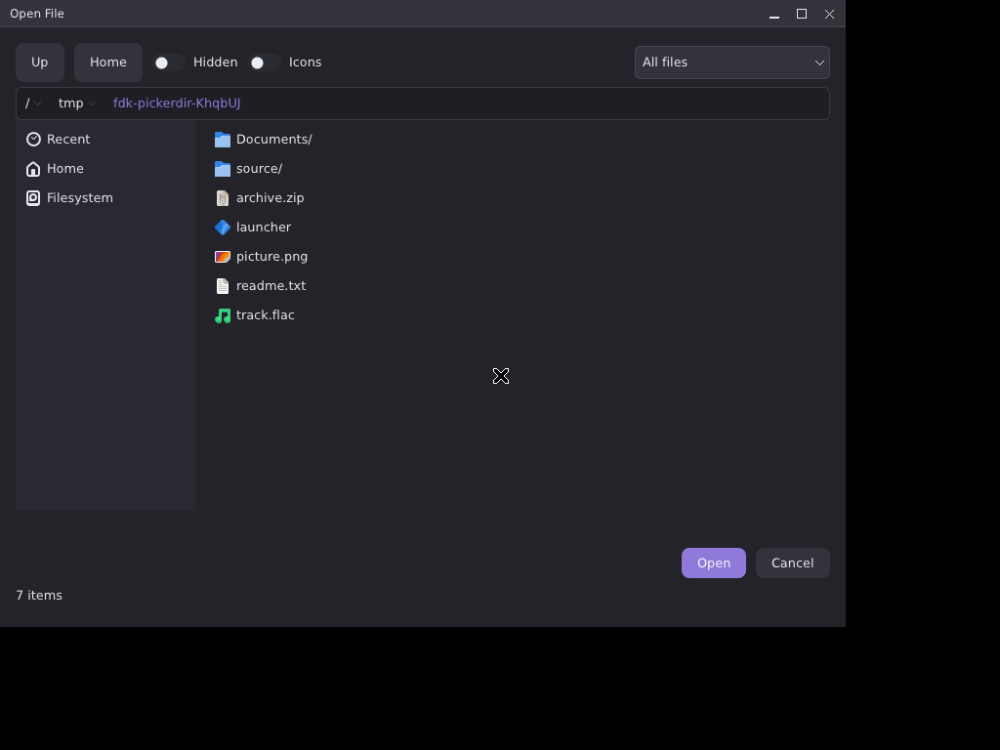
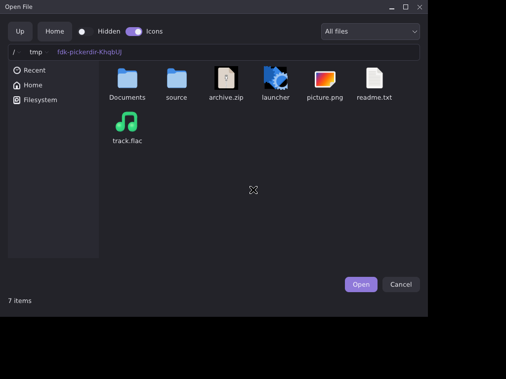

# FDK — Captured Proof Gallery

Every image here is a real captured frame from the test rigs — not a
mockup. Captures come from Xvfb + `x11grab` on the X11 side, and from
compositor screenshot paths (weston/sway headless, wlr-screencopy) on
the Wayland side. Since the Wayland deferred-first-frame fix
(milestone 1.1.1) the whole example suite runs on both backends under
the test rigs: every example is launched in the same
show -> paint -> pump order a real application uses,
screenshot-verified, then closed through the real close path. Some
early proofs show example names from before the suite was
consolidated; the feature proofs are unchanged.

## The consolidated example suite on Wayland

Real compositor output from sway (headless, wlr-screencopy):

## Rendering proofs (X11)

The demo window at 640x480, and again after a live resize to 800x600
— the framebuffer follows the resize and the content repositions into
the new bounds. The dark area around each window is the bare Xvfb
root window, kept in frame on purpose: it shows the window boundary
is real.

## Rendering proofs (Wayland)

The same example under Wayland (weston 14, headless backend,
compositor screenshot), captured 3.5 seconds apart. The gradient
occupies the whole frame because the kiosk shell configures the
surface fullscreen; the shifted colors between the two frames show
the animation genuinely advancing frame by frame on the Wayland
present path.

A 10-second screencast of the animated X11 session — including the
live resize and a clean window close mid-render — is committed
alongside the stills:
[`screenshots/fdk_render_x11.mp4`](screenshots/fdk_render_x11.mp4).

## Widget foundation

Two frames of the Phase 4 foundation demo (since folded into the
widget catalog, `examples/04_widgets.c`) under Xvfb, driven by real
injected input (XSendEvent through the X server): the initial state,
and after two button clicks plus a Tab. Between the frames the meter
recolored AND grew (a `set_bounds` layout change repainting only the
affected region), and the "hue" button's color shifted because
keyboard focus moved to it. The quit button ends the demo by
destroying the window from inside its own pointer-release handler —
and the process exits cleanly (exit 0, ~390 frames).

## Layout engine

The layout demo (its grid now lives in the "Layout — grid" frame of
`examples/04_widgets.c`) held at two different window sizes during
its steady phases: the header dots stay anchored top-left, the
expanding panel owns whatever space the window gives it, the footer
stays pinned to the bottom. Nothing in the example computes geometry
by hand.

## Text stack

The raw-rendering half of `03_text` in its deterministic hold frame
(real shaped glyphs, PIL-verified down to the colored runs and the
stats footer):

Text layout's proof — the label-mode half of `03_text` at full width
and after the rig narrows the window: the paragraph re-wraps from
five lines to seven and the truncated line's ellipsis moves left with
the edge.

## Widget catalog

The widget catalog in its deterministic hold frame: real title bands,
a toggle, checkboxes, a checked radio (the accent dot), buttons, a
full progress bar, and the status label — every element PIL-verified
by the test rig:

## Theme engine

`05_theme` cycling its faces (the built-in Faded Dream, Daylight from
a complete `.fdk` file, Matrix from a deliberately partial one, and
the source tree's `.FDKThemes/` folder): same widgets, same layout,
same code; only the default theme differs between captures. The rig
also verifies the round trip back to the default face is pixel-exact.

## Decorations and window management

Decorated (note the FDK band: title, the three management buttons,
themed rule — at the post-drag position) vs. toggled back to WM
decorations (band gone, content reflows to the full window):

The Phase 8 completion, driven by real input in the test rig:
decorated and dragged; then MAXIMIZED via the band's own maximize
button (fills the screen); then restored by double-clicking the band
and GROWN 460x300 -> 500x330 by dragging the bottom-right resize
corner FDK draws:

## Advanced widgets

The Phase 9 completion, same rig, same discipline — `07_advanced`
driven by real clicks through the X server: (1) the File menu open
below its bar title — a toolkit-owned popup the demo never paints
itself; (2) a ComboBox dropdown; (3) the modal message dialog (its
own toplevel, grabbing input server-side); (4) a nested submenu
chain, each level its own popup. Escape peels the chain one level per
press; the rig's XQueryTree assertion proves every popup window left
the X server when the chain closed:

## The narrator

The embedded narrator demo (`08_narrator`): a scripted tour walks
focus through a form while the narrator speaks each move through a
subtitle bar (also referenced from `docs/roadmap.md`):

## Applications

The capabilities example mid-typing on X11 (1024x768):

The file dialog's new-folder prompt on X11:

The file picker wearing the DESKTOP's own icons — every file type
distinct: folders, archives, executables, images, text, audio. Both
views were captured with NO theme override at all: the engine found
the system default channel on its own (/usr/share/icons/default ->
Adwaita here). The list view resolves the theme's 16-px PNGs; the
grid's 48-px cells are RASTERIZED FROM SVG (Adwaita ships no 48-px
PNGs — the vendored nanosvg renders the scalable assets at the
requested size, verified pixel-level against an independent cairo
reference). Since 1.5.3 the icons composite with true per-pixel
alpha — the transparent surround around every artwork shows the row
or cell background (the earlier builds painted an opaque black box
there), and the detection chain reads the LIVE desktop through
XSETTINGS on X11 in addition to the file channels. Captured on X11:

FDK Files (`examples/10_file_manager.c`) — column view on X11, and
the home folder on Wayland:

